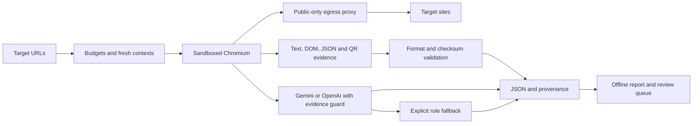

# ScamTrace

ScamTrace is a small website-investigation agent for the [TRM challenge](https://007.trmlabs.com/).
It follows observed, permitted controls, gathers rendered evidence, validates BTC,
TRON and EVM address candidates, and writes JSON plus an offline evidence report.
The implementation uses Python, Playwright and an explicit observe–choose–act loop.
Gemini is the provider used in the recorded run; OpenAI and a free rule baseline
are also supported. Addresses come from captured sources and deterministic checks,
never from model-generated wallet lists.

## Submission results and limitations

Open `outputs/submission/report.html` to inspect the packaged report immediately.
The final JSON is `outputs/submission/submission.json`. No rerun is needed.

| Recorded reviewed result | Count |
| --- | ---: |
| Unique input URLs processed | 160 |
| Analyzed sites | 55 |
| Unreachable sites | 84 |
| Sites with HTTP errors | 21 |
| SCAM investigation flags | 11 |
| NOT_SCAM records | 149 |
| Model verdicts | 57 |
| Rule fallbacks after API server errors | 19 |
| Records requiring review | 160 |
| Address sightings / unique addresses | 50 / 48 |
| Verified scam deposit wallets | 0 |

These are best-effort investigation results, not verified findings of fraud or safety.
`NOT_SCAM` on inaccessible or insufficient evidence is an unresolved binary placeholder,
used because the challenge requests two labels. Classification accuracy and address
recall are unmeasured: no independently labeled evaluation set was supplied.

The address sightings comprise 33 possible contracts, 16 unknown roles and one null
address. A previously marked payment candidate appeared in currency metadata and
matched the Ethereum USDC token contract; it was corrected. Every validated address discovered on a flagged site is retained in
`crypto_addresses`, as the briefing requests, with source, context and role attached.
The recorded flagged sites contain one contract-address sighting from a market widget;
it is not a verified deposit recipient. `address_candidates` retains all sightings
across all sites. No payment recipient was verified. The real scam-address screenshot bonus has therefore not been demonstrated.

All 11 flags retain exact supporting quotations. Four—onestopchoices.com, renega.nl,
test.fxtrading.lol and varumi.nl—are weaker leads based on site inconsistencies.
They are not independently verified scams. A model can still misinterpret a quotation.

The latest crawler improvements recognize narrowly allowed SPA controls and explore
previously observed same-origin links after a dead end. A focused public investigation
of four sites reached login/recharge pages but established no genuine deposit recipient.
The full 160-site scan was not repeated after these navigation changes.
The full review retains original assessments and the repair configuration for provenance.

## Setup and reproduction

Use Docker Desktop, or Docker Engine with Compose. Python 3.11+ is required for local
development; Python 3.12 was tested. The Docker image uses Python 3.12. Chromium remains
sandboxed; do not disable its sandbox or use privileged containers to resolve startup
problems. A disposable VM provides additional isolation when investigating untrusted sites.

```sh
mkdir -p outputs
export SCAMTRACE_UID="$(id -u)" SCAMTRACE_GID="$(id -g)"
cp .env.example .env
```

For Gemini, fill these fields in `.env` locally:

```env
GEMINI_API_KEY=your_key_here
GEMINI_MODEL=gemini-3.1-flash-lite
```

The model must be available in your account. Quotas and billing are account-dependent;
request spacing is not a spending cap. Never commit or submit `.env` or credentials.
The SDK imports `openai`, but Gemini requests use Google's compatible endpoint and
`GEMINI_API_KEY`; an OpenAI key is not required for Gemini.

Build the services:

```sh
docker compose build
```

Start with a small live pilot. The first three manifest targets were inaccessible
in the recorded run, so this example uses three sites that previously rendered:

```sh
cat > outputs/pilot-targets.txt <<'URLS'
https://elite-crown.com
https://smartgrowsavings.com
https://windrushs.co
URLS

docker compose run --rm scanner run \
  --llm --provider gemini \
  --targets outputs/pilot-targets.txt \
  --concurrency 1 --llm-interval 6 --timeout 150 \
  --output outputs/new-pilot
```

Inspect `errors`, recorded token usage and `analysis_mode` before a full run.
A completed scan can contain rule fallbacks and does not prove that every API call
succeeded. Successful usage does not establish classification accuracy. Zero recorded
usage does not prove a failed request was uncounted or unbilled by the provider.

```sh
docker compose run --rm scanner run \
  --llm --provider gemini --targets targets.txt \
  --steps 12 --concurrency 1 --llm-interval 6 --timeout 150 \
  --output outputs/new-full
```

For a free rule-only run, omit `--llm`. For OpenAI, configure `OPENAI_API_KEY` and
`OPENAI_MODEL`, then use `--llm --provider openai`; live OpenAI calls were not validated.
The default browser exploration uses rules, preserving one model classification call
per observed site. Optional `--llm-navigation` uses the model for action choices and
increases requests. SDK retry behavior differs by provider; Gemini retries are disabled.
Browser actions, concurrency, text sizes and request starts are bounded.

`--resume` reuses checkpoints marked `analyzed` when recorded configuration matches.
That includes analyzed records whose API classification fell back to rules; resume
is not an automatic retry of those model failures. Other incomplete statuses are retried.
Use a fresh output directory when changing settings or reviewing a different code version.

The UID/GID settings apply to the scanner so output files remain writable without
world-writable permissions. On Linux ARM, the QR dependency may compile from source;
the Docker builder provides C++ tools and installs built wheels into the runtime image.

## Saved-evidence review and outputs

The recorded full run was reclassified from saved observations without another crawl.
Original assessments are retained in `previous_assessment` and `original-results.json`.
Token counts in the reviewed records describe the review pass; prior usage is retained
in the previous assessments. The recorded scan used conservative 30-second API spacing;
review and focused investigations are separate passes.

A new saved-evidence review can be run as follows. This makes new model calls only for
records with observations; omit `--llm` for a conservative offline review:

```sh
docker compose run --rm -T --no-deps --entrypoint python scanner \
  -m scamtrace.repair outputs/submission/results.json \
  --output outputs/new-review --llm --provider gemini --interval 6
```

The repair command requires a fresh output directory. It copies available referenced
screenshots, preserves earlier assessments, and records unavailable images rather than
fabricating them. A reduction in flag count is not proof of improved accuracy.

| Packaged artifact | Purpose |
| --- | --- |
| `outputs/submission/submission.json` | Compact final JSON: URL, classification, addresses and review context |
| `outputs/submission/results.json` | Full observations, action history, errors, quotes and prior assessments |
| `outputs/submission/summary.json` | Coverage, modes, address roles and structural validation |
| `outputs/submission/review_queue.json` | Decisions requiring human review |
| `outputs/submission/report.html` | Offline escaped report with evidence and screenshots |
| `outputs/submission/evidence/` | Actual browser screenshots referenced by the reviewed results |

The 179 screenshot reference occurrences in the reviewed records resolve to packaged
files. Original assessments preserve historical source paths; the reviewed report uses
the copied reviewed evidence. Structural auditing checks URL coverage, address validity
and quotation grounding, not real-world correctness:

```sh
docker compose run --rm -T --no-deps scanner \
  audit outputs/submission/results.json --targets targets.txt
```

## Architecture



| Module | Responsibility |
| --- | --- |
| `models.py` | Structured observations, addresses, verdicts and results |
| `browser.py` | Rendered observations, restricted navigation, login, JSON and QR capture |
| `addresses.py` | Candidate detection, checksums, context roles and sighting deduplication |
| `policy.py` | Allowed controls, restricted actions, URL and origin validation |
| `judge.py` | Structured decisions, grounded quotes, conservative verdicts and fallback |
| `runner.py` | Site budgets, concurrency, observed-link frontier and checkpoints |
| `repair.py` | Saved-evidence reclassification and portable reviewed artifacts |
| `output.py` / `report.py` | Compact output, structural audit, summaries and escaped HTML |
| `security/proxy.py` | Public IP validation, DNS pinning and HTTP/HTTPS forwarding |

Each site has a fresh context. Browser code observes visible text, input values excluding
passwords, attributes, bounded inline scripts, frames, site-requested JSON responses and
QR codes. JSON capture is limited to 128 KB decoded text; headerless responses use the
observed transfer size. Visible QR images/canvases below the viewport are also bounded.
Stale controls are refused, and the frontier contains only links previously observed.
A small allowlist recognizes SPA recharge/currency controls without unrestricted clicks.

BTC and TRON candidates require checksums. Mixed-case EVM addresses require EIP-55;
lowercase/all-uppercase EVM addresses are marked format-only. An EVM address alone does
not establish the chain, asset, operator ownership or role. The same format can be used
for ETH and ERC-20 USDT/USDC; TRON addresses also do not establish token ownership.

## Assumptions, evidence guard and distinctive choices

The target scenarios include fake exchanges, phishing, deceptive investment/task schemes
and pig-butchering-related fronts. High offered returns, advance-fee withdrawals and
requests for recovery secrets are review signals. Crypto use, gambling, ordinary login,
dropshipping, missing company details and unfamiliar domains alone do not establish fraud.

The baseline flags offered rates of at least 5%, within 31 days, averaging at least
0.65% per day. Weekly/monthly and split plan layouts require investment context. These
are subjective heuristics, not calibrated fraud thresholds; monthly rates paid daily
remain monthly. The baseline can still misinterpret quoted or educational content.

The model receives the review date and is instructed not to invent prices, reputation,
regulatory findings, stolen keys, fabricated activity or contract execution results.
Quote matching tolerates whitespace differences but returns the original source substring.
Local rule signals remain flagged for review. Provider phishing warnings are attributed
as warnings, not independently established fraud. Model-labeled conflicts require two
grounded statements; code verifies their presence, not whether they logically contradict
one another or prove fraud. Every guarded decision therefore requests human review.

The distinctive choices are provenance-first address extraction, deterministic validation,
a restricted observed-control loop, cross-site address leads and a saved-evidence repair
pass. Repeated contracts or service infrastructure are not treated as shared scam ownership.
The model never fabricates a missing address or claims that unreachable sites are safe.

## Authorized login flows

Login links can be explored. Supported login submission requires an explicitly supplied,
existing disposable research account. The agent does not invent credentials, create
accounts, accept terms, bypass CAPTCHA/MFA/KYC, or connect a wallet. Some custom forms
are unsupported. Real authenticated deposit extraction was not demonstrated; the successful
login fixture is synthetic and uses fixture-only credentials.

Configure a local `credentials.json` with this shape:

```json
[{"origin":"https://example.com","username":"research-account","password":"unique-research-password"}]
```

Mount it only into the scanner:

```sh
docker compose run --rm \
  -v "$PWD/credentials.json:/app/credentials.json:ro" scanner \
  run --llm --provider gemini --credentials credentials.json \
  --targets targets.txt --output outputs/new-authenticated
```

Supported forms have one password field, a recognized username/email field and one
login button. Checkbox/file-input forms are skipped. A logged action says `submitted`,
not `authenticated`; subsequent observations are needed to establish the result.

## Security boundaries

Chromium runs non-root with its sandbox, dropped capabilities, a namespace seccomp
profile, a read-only filesystem, and temporary directories. The browser has no host
file mount, published port, Docker socket, API key or personal browser profile.
It reaches external sites only through the public-only proxy on its internal network.
Downloads and permissions are disabled; dialogs are dismissed and popups closed.

The proxy rejects private/loopback/link-local/reserved addresses and mixed public/private
DNS answers. It connects to independently checked IPs without a second DNS lookup, and
tries validated public answers within a shared deadline. Plain HTTP allows GET/HEAD on
standard ports. HTTPS uses an opaque CONNECT tunnel: it is not application-write filtering.
Allowed public redirects and site-initiated requests may reach other public origins.

Website content is untrusted data. Action restrictions exist outside the model, but prompt
injection and misleading claims can still affect verdicts. The report escapes captured
strings and makes no live scam-site requests. A container/proxy is not a proven malware
containment boundary; see `security/README.md` for the design and limitations.

## Tests and validation

The packaged source passes 51 unit tests on Python 3.12. Eleven synthetic browser cases
pass: hidden deposit navigation, legitimate donations, authorized fixture login, viewport
QR, off-screen QR, network selection, observed JSON, headerless JSON, missing pages,
plain SPA recharge controls and exploring another observed branch after a dead end.
Fixtures use public example addresses and are not real scam-wallet evidence.

```sh
python3.12 -m venv .venv
source .venv/bin/activate
python -m pip install -c requirements.lock -e .
python -m playwright install chromium
python -m unittest discover -s tests
python -m scripts.demo
```

The demo fulfills every request locally under `fixture.example`. It makes no external
site or model calls. Tests do not establish precision, recall or complete containment.
These workflow tests do not demonstrate real authenticated deposit-wallet recovery.

## Alternatives and tradeoffs

| Alternative | Tradeoff |
| --- | --- |
| HTTP-only scraper | Simpler/faster, but misses rendered navigation, forms and QR codes |
| Unrestricted computer-use agent | More flexible, but harder to constrain and reproduce |
| LLM-only address extraction | Risks invented addresses and transcription errors |
| Large agent framework | More abstractions than this small loop needs |
| Trained classifier | Needs independent labels and a measured evaluation set |
| Reputation/on-chain APIs | Can strengthen verification, but add credentials, cost and attribution limits |

Conservative gates can reduce recall. Rule-driven navigation reduces model requests but
may miss complex interactions. Bounded exploration cannot exhaust every gated path.
Free-tier model selection helped with quota availability; higher quotas alone do not
make slow sites accessible or guarantee correct classification. Reviewers can inspect
the saved artifacts immediately rather than repeat the live scan.

## Improvements with more time

1. Independently label a representative evaluation set and measure classification and
   deposit-address recall separately, including gated and unreachable cases.
2. Validate authorized real login flows, custom forms, shadow DOM, clipboard addresses
   and dynamic QR/network controls using controlled research accounts.
3. Improve retry/backoff and semantic contradiction verification without hiding failures
   or promoting generic interface elements to proof of deception.
4. Verify contract roles and address attribution with chain-specific evidence, and assess
   cross-site templates as leads rather than assumed shared ownership.
5. Expand network-isolation/DNS-rebinding tests and benchmark budgets, runtime and API usage.

## Development and private submission

The implementation was developed with AI assistance. Synthetic fixtures are implementation tests, not real-target accuracy measurements.
This package contains source, setup, README, reviewed JSON and evidence screenshots,
but does not fully demonstrate scam deposit-wallet recovery or measured accuracy.

Use the challenge's private submission process: the brief specifies a ZIP or a private
GitHub repository shared with `@rraina`. Exclude `.env`, credentials, virtual environments
and caches. `.env.example` contains empty key fields. No submission/public post was made
by the agent. The reviewer entry points are this README and `outputs/submission/report.html`.
